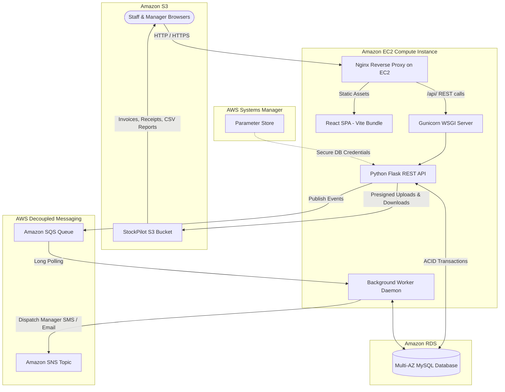

# 📦 StockPilot — Smart Inventory, Expiry & Reorder Management System

> **Cloud Computing Laboratory (CCL) Mini-Project**  
> Complete full-stack web application running on Amazon EC2 with multi-service AWS cloud integration (RDS, S3, SQS, SNS, SSM Parameter Store).

---

## 🎯 Executive Summary & Problem Statement

Small grocery stores, supermarkets, college canteens, and stationery shops face severe operational challenges:
1. **Perishable Wastage**: Without batch-level expiry tracking, items expire unnoticed on shelves.
2. **Stockouts & Stock Glut**: Manual replenishment causes frequent stockouts of fast-moving essentials or excessive capital locked in slow-moving stock.
3. **Audit Discrepancies**: Lack of an immutable stock ledger leads to shrinkage, unaccounted write-offs, and discrepancies.
4. **Disorganized Paperwork**: Supplier invoices and delivery receipts are misplaced.

**StockPilot** resolves these challenges by providing an automated cloud inventory platform with batch-level FEFO/FIFO dispatching, proactive expiration alerts via Amazon SNS, asynchronous event decoupling via Amazon SQS, and dynamic sales velocity reorder recommendations.

---

## ☁️ Cloud Architecture & AWS Services



### AWS Cloud Integrations Breakdown

| AWS Service | Architecture Role & Value |
| :--- | :--- |
| **Amazon EC2** | Compute layer running Ubuntu 22.04 LTS, Nginx web server, Gunicorn WSGI processes, and systemd worker daemons. Decoupled from serverless execution limits. |
| **Amazon RDS MySQL** | High-durability managed relational database enforcing ACID compliance across products, batches, ledger transactions, alerts, and roles. |
| **Amazon S3** | Secure object storage for supplier invoice attachments, delivery proofs, and analytical CSV ledger exports utilizing temporary Pre-Signed URLs (1-hour validity). |
| **Amazon SQS** | Asynchronous message queue buffer. Decouples critical path web transactions (e.g., stock checkout) from background alert analysis and notification dispatching. |
| **Amazon SNS** | Push notification topic delivering real-time low-stock and near-expiry alerts to store managers via Email and SMS. |
| **AWS SSM Parameter Store**| Centralized secrets management storing database credentials, eliminating hardcoded passwords and environment drift. |
| **Amazon CloudWatch** | Centralized application metric dashboards and structured JSON error audit logging. |

---

## 🧠 Key Algorithmic Features

### 1. FEFO (First-Expired, First-Out) Dispatch Engine
When recording sales or issuing items, StockPilot automatically allocates deductions from the batch with the **earliest expiry date first** (`expiry_date ASC, id ASC`). This directly eliminates shelf expiration losses. Non-perishable items default to strict FIFO (First-In, First-Out).

### 2. Dynamic Reorder Advisor Algorithm
Rather than static guesses, StockPilot continuously computes real-time consumption rates:
$$\text{Avg Daily Velocity } (V) = \frac{\sum \text{Sales in last 30 days}}{30}$$
$$\text{Reorder Point (ROP)} = (V \times \text{Lead Time Days}) + \text{Safety Buffer}$$
$$\text{Suggested Reorder Quantity} = \text{Target Stock Level} - \text{Current Stock}$$

## 🚀 How to Run This Project

### Prerequisites
- **Python 3.10+**
- **Node.js 18+ and npm**

---

### Option A: One-Click Quickstart (Windows)
If you are on Windows, you can launch both services simultaneously with the bundled batch scripts:

1. **First-time setup:**
   - In `backend/`: create your virtual environment, install requirements (`pip install -r requirements.txt`), and seed demo data (`python seed.py`).
   - In `frontend/`: run `npm install`.
2. **Double-click `run_all.bat`** in the project root:
   - This opens two dedicated command windows:
     - **Backend API Server:** Running Flask on `http://localhost:5000`
     - **Frontend Client:** Running Vite React dev server on `http://localhost:5173`
3. Open your browser and go to **`http://localhost:5173`**

---

### Option B: Step-by-Step Manual Run (Windows / macOS / Linux)

#### 1. Backend Setup & Run
Open a terminal in the project root:
```bash
# Navigate to backend directory
cd backend

# Create virtual environment
python -m venv venv

# Activate virtual environment
# On Windows (cmd/PowerShell):
.\venv\Scripts\activate
# On Linux/macOS:
source venv/bin/activate

# Install dependencies
pip install -r requirements.txt

# (Optional) Copy environment template
cp .env.example .env

# Seed the database with sample inventory, users, and transactions
python seed.py

# Start the Flask API server (runs on http://localhost:5000)
python run.py
```

*(Optional)* In a separate terminal with the virtual environment activated, run the background worker daemon (for SQS event processing & expiry checks):
```bash
cd backend
python worker.py
```

#### 2. Frontend Setup & Run
Open another terminal:
```bash
# Navigate to frontend directory
cd frontend

# Install dependencies
npm install

# Start Vite dev server (runs on http://localhost:5173)
npm run dev
```

Visit **`http://localhost:5173`** in your browser. All `/api` requests are automatically proxied to `http://localhost:5000`.

---

## 🔑 Demo & Evaluation Login Credentials

Once the servers are running, log in with either of the pre-seeded accounts:

| Role | Username | Password | Privileges & Workflows |
| :--- | :--- | :--- | :--- |
| **Store Manager** | `manager` | `manager123` | Full access: Executive analytics, add/edit products, suppliers, stock write-offs, S3 invoice vaulting, and dynamic reorder settings. |
| **Floor Staff** | `staff` | `staff123` | Operational access: Counter stock receipt, issuing/sales, FEFO batch inspection, and alert monitoring. |

---

## 📖 In-Depth Project & Cloud Architecture Documentation
For a complete academic and technical breakdown of all 7 AWS cloud services, architectural diagrams, FEFO/ROP algorithms, and lab evaluation Q&A, refer to **[`project explanation.md`](./project%20explanation.md)** in the project root.

---

## 🛠️ Automated Production Deployment on AWS EC2

1. Launch an **Ubuntu 22.04 LTS** EC2 instance (`t3.small` recommended).
2. Attach an IAM Role with permissions for `AmazonS3FullAccess`, `AmazonSQSFullAccess`, `AmazonSNSFullAccess`, and `AmazonSSMReadOnlyAccess`.
3. SSH into your EC2 instance and clone your repository:
   ```bash
   git clone <your-repo-url> /home/ubuntu/stockpilot
   cd /home/ubuntu/stockpilot
   chmod +x deploy/setup_ec2.sh
   ./deploy/setup_ec2.sh
   ```
4. Access the web dashboard using your EC2 Public IP address!
