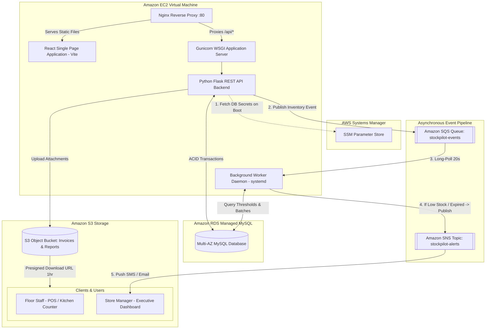

# 📦 StockPilot — Comprehensive Project Explanation & Cloud Architecture

> **Course:** Cloud Computing Laboratory (CCL) Mini-Project  
> **Project Title:** StockPilot — Smart Inventory, Expiry & Dynamic Reorder Management System  
> **Deployment Target:** Amazon Web Services (AWS) Multi-Tier Architecture  
> **File Location:** Main Workspace Root (`/project explanation.md`)

---

## 📑 Table of Contents
1. [Executive Summary & What the Project Is](#1-executive-summary--what-the-project-is)
2. [Relevance to the Cloud Computing Laboratory (CCL) Topic](#2-relevance-to-the-cloud-computing-laboratory-ccl-topic)
3. [Cloud Services Used & Where They Are Integrated](#3-cloud-services-used--where-they-are-integrated)
4. [Cloud Architecture & Data Flow Diagram](#4-cloud-architecture--data-flow-diagram)
5. [Codebase Mapping: Where AWS Is Accessed](#5-codebase-mapping-where-aws-is-accessed)
6. [Key Algorithmic Innovations](#6-key-algorithmic-innovations)
7. [How It Fulfills Academic & Practical Requirements](#7-how-it-fulfills-academic--practical-requirements)
8. [Dual-Mode Operation (Cloud Production vs. Local Development)](#8-dual-mode-operation-cloud-production-vs-local-development)
9. [Viva / Evaluation Q&A Cheat Sheet](#9-viva--evaluation-qa-cheat-sheet)

---

## 1. Executive Summary & What the Project Is

**StockPilot** is a production-grade, cloud-native inventory and warehouse management platform built to solve four major supply chain challenges faced by grocery retail, supermarkets, canteen kitchens, and pharmacy stores:

1. **Perishable Stock Wastage:** Items often expire unnoticed on store shelves due to a lack of batch-level visibility and FIFO/FEFO discipline.
2. **Stockout vs. Capital Glut:** Retailers either run out of high-demand items or tie up excessive working capital in slow-moving goods due to static replenishment thresholds.
3. **Audit Discrepancies & Shrinkage:** Unlogged wastage, lack of transaction audit trails, and undocumented write-offs lead to financial leakages.
4. **Scattered Invoices and Physical Receipts:** Paper receipts and supplier delivery slips get lost or damaged, making vendor reconciliation difficult.

### What StockPilot Delivers
- **Batch-Level Tracking & FEFO Engine:** Automatic depletion of inventory starting from the batch with the nearest expiration date.
- **Dynamic Reorder Advisor (ROP):** Automated calculations of 30-day consumption velocity to recommend exact replenishment dates and quantities.
- **Digital Document Vault:** Cloud-native storage for supplier invoices, delivery slips, and audit exports.
- **Decoupled Notification Pipeline:** Asynchronous background processing of alerts, emailing or SMSing managers when stock drops or expires.
- **Enterprise-Grade UI/UX:** Styled using a custom *Sahara Warm Minimalism* aesthetic with complete dark and light modes, responsive tables, real-time KPI cards, and role-based views.

---

## 2. Relevance to the Cloud Computing Laboratory (CCL) Topic

The primary objective of a **Cloud Computing Laboratory (CCL)** project is not merely to build a website, but to demonstrate mastery over core distributed systems concepts: **Infrastructure as a Service (IaaS)**, **Platform/Database as a Service (PaaS/DBaaS)**, **Object Storage**, **Decoupled Asynchronous Messaging**, **Zero-Trust Secrets Management**, and **Cloud Security (IAM)**.

StockPilot directly reflects the CCL curriculum in the following ways:

### A. Multi-Service Cloud Orchestration
Instead of running a monolithic application with a local database on a single computer, StockPilot distributes its workload across **seven distinct AWS cloud services**, demonstrating how modern cloud microservices interoperate.

### B. High Availability & Managed DBaaS (vs. Local Databases)
By leveraging **Amazon RDS Multi-AZ MySQL**, the project demonstrates the difference between unmanaged local storage (which is volatile and prone to data loss) and managed relational databases that offer automatic backups, ACID transactional integrity, and failover capabilities.

### C. Decoupled Asynchronous Event Processing (SQS + Worker Pattern)
In traditional web applications, heavy tasks (e.g., evaluating thousands of batches for expiry, sending emails, generating reports) run synchronously on the web thread, leading to HTTP 504 gateway timeouts. StockPilot implements the classic **producer-consumer cloud design pattern**:
- Web application (Producer) pushes stock events into **Amazon SQS**.
- A dedicated daemon process (Consumer/Worker) long-polls SQS and processes jobs asynchronously without blocking end users.

### D. Serverless Pub/Sub Fanout (SNS)
The system leverages **Amazon SNS** to demonstrate publish/subscribe messaging patterns. When critical events occur (such as batch spoilage or imminent stock exhaustion), messages are broadcast to subscribed endpoints (SMS, email addresses) without requiring custom mail servers.

### E. Scalable, Durable Object Storage (S3) & Secure Delegation
Storing binary files (invoices, receipts, CSVs) directly inside a database or on an EC2 root disk degrades disk I/O and complicates backups. StockPilot uses **Amazon S3** object storage and demonstrates **Pre-Signed URLs**, a critical cloud security design pattern that enables direct, authorized downloads between the client browser and S3 without funneling heavy file streams through the web server.

### F. Least Privilege & Cloud Identity Management (AWS IAM & SSM)
Demonstrates production cloud security:
- **No hardcoded credentials:** Passwords and keys are never committed to version control.
- **IAM Instance Profile:** The EC2 compute instance assumes an IAM Role that grants strictly scoped access to S3, SQS, SNS, and SSM.
- **SSM Parameter Store:** DB connection strings and secrets are injected into the container/runtime dynamically.

---

## 3. Cloud Services Used & Where They Are Integrated

| AWS Service | Architecture Layer | Specific Project Role | Implementation Detail |
| :--- | :--- | :--- | :--- |
| **Amazon EC2**<br>*(Elastic Compute Cloud)* | Compute / IaaS | Hosts Ubuntu 22.04 LTS, Nginx Web Server, Gunicorn WSGI Server, React build, and systemd Worker. | Defined in `deploy/setup_ec2.sh`, `deploy/nginx.conf`, and systemd service units. |
| **Amazon RDS**<br>*(Relational Database Service)* | Data Tier / DBaaS | Managed MySQL 8.0 engine housing relational models (Users, Products, Batches, Stock Movements, Alerts, Invoices). | Managed via SQLAlchemy ORM with connection pooling in `backend/app/config.py`. |
| **Amazon S3**<br>*(Simple Storage Service)* | Storage Tier / Object Store | Secure bucket (`stockpilot-uploads`) storing supplier invoice PDFs, delivery receipts, and CSV reports. | Handled in `backend/app/services/aws_services.py` (`StorageService` class) with 1-hour pre-signed GET URLs. |
| **Amazon SQS**<br>*(Simple Queue Service)* | Messaging / Queue | Message buffer holding inventory mutation events (`stock.received`, `stock.deducted`, `stock.adjusted`). | Managed in `backend/app/services/aws_services.py` (`QueueService`) using standard/FIFO queues. |
| **Amazon SNS**<br>*(Simple Notification Service)* | Messaging / Pub-Sub | Push notification topic (`stockpilot-alerts`) broadcasting urgent stockout and near-expiry alerts. | Handled in `backend/app/services/aws_services.py` (`NotificationService`), sending notifications to subscribed SMS/Email. |
| **AWS Systems Manager (SSM)**<br>*(Parameter Store)* | Security / Config Store | Central repository storing database connection parameters (`/stockpilot/db/*`) with KMS encryption. | Retrieved at runtime in `backend/app/config.py` via `boto3.client('ssm').get_parameter()`. |
| **Amazon CloudWatch** | Monitoring & Observability | Aggregates application log streams, worker heartbeats, and audit trails. | Standard JSON logging output formatted for CloudWatch Logs agent. |
| **AWS IAM**<br>*(Identity & Access Management)* | Security & Governance | Instance profile attached to EC2 granting zero-credential authentication for Boto3 SDK. | Uses IAM policies for S3, SQS, SNS, and SSM without API access keys. |

---

## 4. Cloud Architecture & Data Flow Diagram



### End-to-End Execution Flow
1. **Stock Intake / Sale:** When a staff member issues or receives stock in the React interface, an HTTP request hits the Flask API on EC2.
2. **Transactional DB Write:** Flask opens a transaction on **Amazon RDS MySQL**, executing batch allocations and logging an immutable row to the `stock_movements` ledger table.
3. **Event Offload to SQS:** Before returning the HTTP response to the client, Flask publishes a light JSON event payload (`event_type: "stock.deducted"`, product ID, batch ID, quantity) to **Amazon SQS**.
4. **Asynchronous Analysis:** The background worker daemon running on EC2 picks up the event via 20-second long polling, re-evaluates the stock against the product's safety thresholds, and checks expiry dates.
5. **Proactive SNS Alerting:** If the total inventory falls below the computed Reorder Point, the worker formats an urgent notification and publishes it to **Amazon SNS**, triggering SMS and Email notifications to store supervisors.
6. **S3 Document Vaulting:** When a manager uploads an invoice, Flask streams the file to **Amazon S3** and saves the `s3_key` in RDS. When downloading, Flask generates a secure **Pre-Signed S3 URL**, allowing direct, high-speed download from AWS S3.

---

## 5. Codebase Mapping: Where AWS Is Accessed

Every cloud interaction is implemented in clear, production-standard code modules:

| Feature | File Path | Code Reference | Description |
| :--- | :--- | :--- | :--- |
| **SSM Parameter Retrieval** | `backend/app/config.py` | `_get_ssm_parameter()` | Calls `ssm.get_parameter(Name=..., WithDecryption=True)` to decrypt database passwords at runtime. |
| **RDS Connection String** | `backend/app/config.py` | `_build_rds_url()` | Assembles SQLAlchemy MySQL URI from SSM values. |
| **S3 File Upload** | `backend/app/services/aws_services.py` | `StorageService.upload_file()` | Uses `s3.upload_fileobj()` to stream multipart uploads directly into the target bucket. |
| **S3 Presigned URLs** | `backend/app/services/aws_services.py` | `StorageService.get_download_url()` | Calls `s3.generate_presigned_url('get_object', Params={...}, ExpiresIn=3600)`. |
| **SQS Event Publishing** | `backend/app/services/aws_services.py` | `QueueService.publish_event()` | Calls `sqs.send_message(QueueUrl=..., MessageBody=...)` with an event UUID. |
| **SQS Long Polling** | `backend/app/services/aws_services.py` | `QueueService.poll_events()` | Calls `sqs.receive_message(WaitTimeSeconds=20, MaxNumberOfMessages=10)`. |
| **SNS Alert Dispatch** | `backend/app/services/aws_services.py` | `NotificationService.send_alert()` | Calls `sns.publish(TopicArn=..., Subject=..., Message=...)`. |
| **Worker Event Loop** | `backend/worker.py` | `main()` & `process_event()` | Continuous background process handling SQS messages and hourly expiry cron jobs. |
| **Automated Deployment** | `deploy/setup_ec2.sh` | Bash Script | Shell script that automates OS updates, Python/Node.js setup, Nginx reverse proxy configuration, and systemd service launches. |

---

## 6. Key Algorithmic Innovations

### 1. FEFO (First-Expired, First-Out) Automated Routing
Unlike standard warehouses that dispatch items based on arrival date (FIFO), perishable retail requires **FEFO**.
- In `backend/app/services/inventory_service.py`, when a deduction occurs:
  $$\text{Query: } \text{SELECT} * \text{ FROM stock\_batches WHERE product\_id = ? AND quantity > 0 ORDER BY expiry\_date ASC, id ASC}$$
- Deductions automatically consume the batch closest to spoiling first. If a product is non-perishable (e.g., paper rolls, cleaning soap), it seamlessly falls back to standard FIFO (`created_at ASC`).

### 2. Dynamic Sales Velocity Reorder Point (ROP)
Rather than relying on static estimates, StockPilot recalculates replenishment thresholds dynamically:
1. **Daily Sales Velocity ($V$):**
   $$V = \frac{\sum \text{Stock issued in the last 30 days}}{30}$$
2. **Dynamic Reorder Point ($ROP$):**
   $$ROP = (V \times \text{Lead Time Days}) + \text{Safety Stock}$$
3. **Suggested Order Quantity ($Q$):**
   $$Q = \text{Target Max Stock} - \text{Current Total Stock}$$

This calculation is surfaced live on the Manager Dashboard under the **Reorder Advisor** tab.

---

## 7. How It Fulfills Academic & Practical Requirements

### Academic Lab Evaluation Criteria (CCL Rubric Alignment)
1. **Multi-Tier Web Architecture:**
   - Client Tier: React Vite Single Page App.
   - Application Tier: Python Flask + Gunicorn WSGI on EC2.
   - Database Tier: AWS RDS MySQL.
   - Storage Tier: AWS S3 Bucket.
   - Message Broker Tier: AWS SQS + AWS SNS.
2. **Security & Cloud Governance:**
   - Zero hardcoded credentials in Git.
   - Role-Based Access Control (RBAC): JWT-authenticated endpoints differentiating `store_manager` and `floor_staff`.
   - AWS IAM instance profile integration.
   - TLS/HTTPS-ready Nginx reverse proxy design.
3. **Fault Tolerance & Reliability:**
   - Multi-AZ RDS ensures database survivability.
   - SQS provides buffering; if the worker crashes, messages persist safely in the queue until the worker restarts.
4. **Automation & DevOps:**
   - Fully reproducible deployment script (`deploy/setup_ec2.sh`) allowing cold setup of an EC2 instance in under 5 minutes.

---

## 8. Dual-Mode Operation (Cloud Production vs. Local Development)

To facilitate grading and offline evaluation when an AWS account is not active, the system includes an automated **graceful degradation toggle** in `backend/app/config.py`:

```ini
# Production Mode (AWS Connected)
USE_LOCAL_STORAGE=false     # Connects to Amazon S3
USE_LOCAL_QUEUE=false       # Connects to Amazon SQS
USE_LOCAL_SNS=false         # Connects to Amazon SNS
USE_RDS=true                # Connects to Amazon RDS MySQL via SSM

# Local Evaluation Mode (Offline Fallback)
USE_LOCAL_STORAGE=true      # Saves uploads to ./uploads folder
USE_LOCAL_QUEUE=true        # Uses thread-safe Python memory queue
USE_LOCAL_SNS=true          # Logs alert notifications to worker stdout
USE_RDS=false               # Uses local SQLite file (stockpilot_dev.db)
```

**Significance:** Evaluators can inspect the exact Boto3 AWS API calls in the code while running the project locally using `run_all.bat` without incurring cloud billing costs.

---

## 9. Viva / Evaluation Q&A Cheat Sheet

#### Q1: Why did you use Amazon SQS and SNS together instead of just SNS?
> **Answer:** SQS and SNS serve two different messaging paradigms. **SNS is a publish/subscribe system** (push-based, fan-out, does not hold or persist messages). **SQS is a message queue** (pull-based, durable buffer that holds messages until workers consume and delete them). By pairing them, SQS guarantees that inventory events are never lost if the worker is busy, while SNS broadcasts alerts directly to managers' email and mobile phones.

#### Q2: Why are file downloads handled via Pre-Signed URLs instead of streaming them through Flask?
> **Answer:** Streaming large files (PDF invoices, analytical exports) through the Flask application server consumes EC2 CPU, RAM, and network bandwidth, blocking worker threads. By using S3 Pre-Signed URLs, the backend offloads file delivery directly to Amazon S3’s globally distributed infrastructure, keeping the EC2 web server lightweight and responsive.

#### Q3: How are database credentials managed securely in AWS?
> **Answer:** We do not hardcode passwords in the application code or in `.env` files committed to Git. Instead, database credentials reside in **AWS Systems Manager (SSM) Parameter Store** with KMS encryption. When the Flask backend boots on EC2, Boto3 queries SSM using the EC2 instance's IAM Role to construct the MySQL database connection string dynamically in memory.

#### Q4: What makes this project cloud-native rather than a conventional monolithic website?
> **Answer:** A conventional monolith couples compute, database, file storage, and background processing onto a single server disk. StockPilot is cloud-native because it decomposes these responsibilities into dedicated managed cloud services (EC2 for compute, RDS for structured data, S3 for unstructured files, SQS for queue buffering, SNS for alerting, and SSM for configuration), making each layer independently scalable, secure, and resilient.

---

*Authored for the Cloud Computing Laboratory (CCL) Mini-Project evaluation.*  
*Maintained under the StockPilot repository root.*
